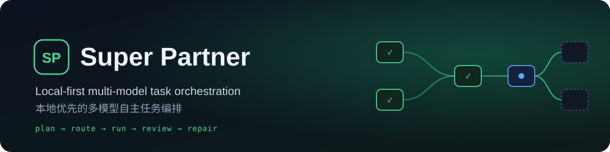
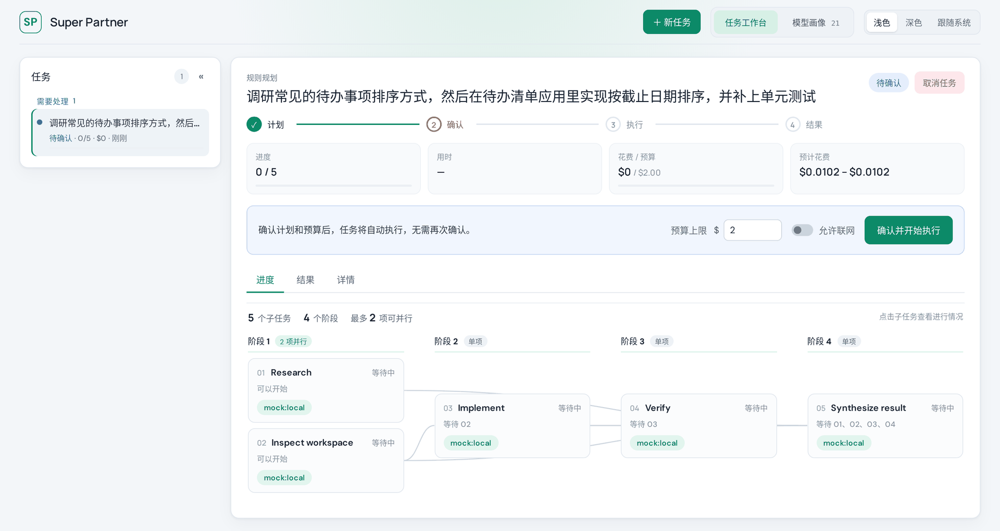
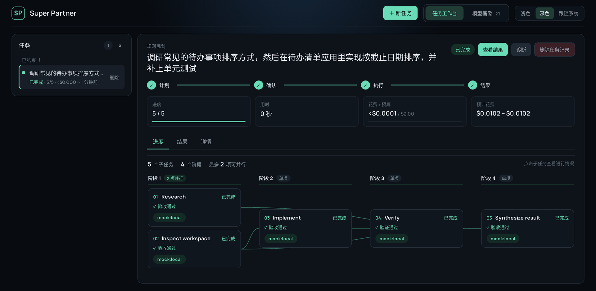
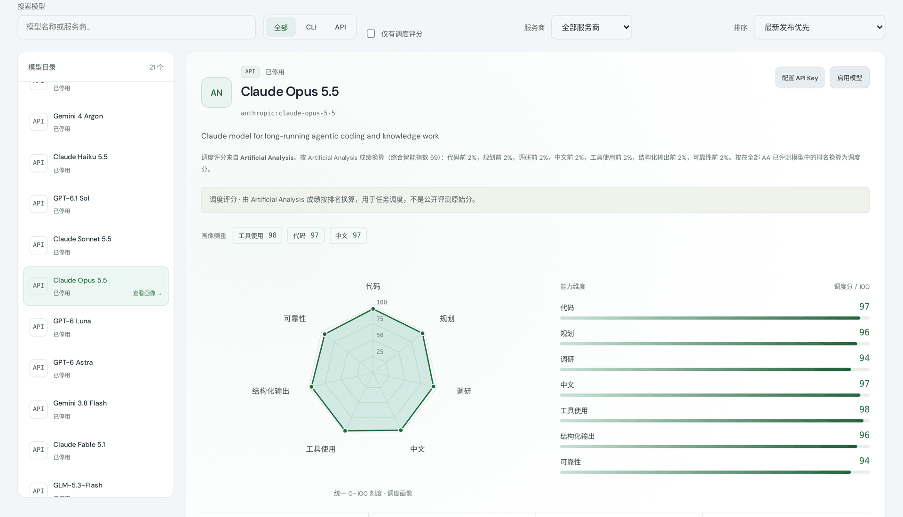
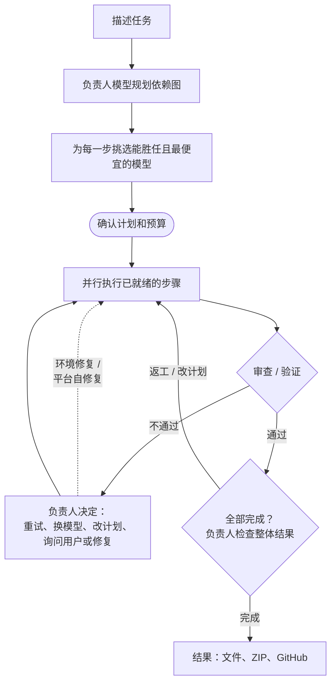
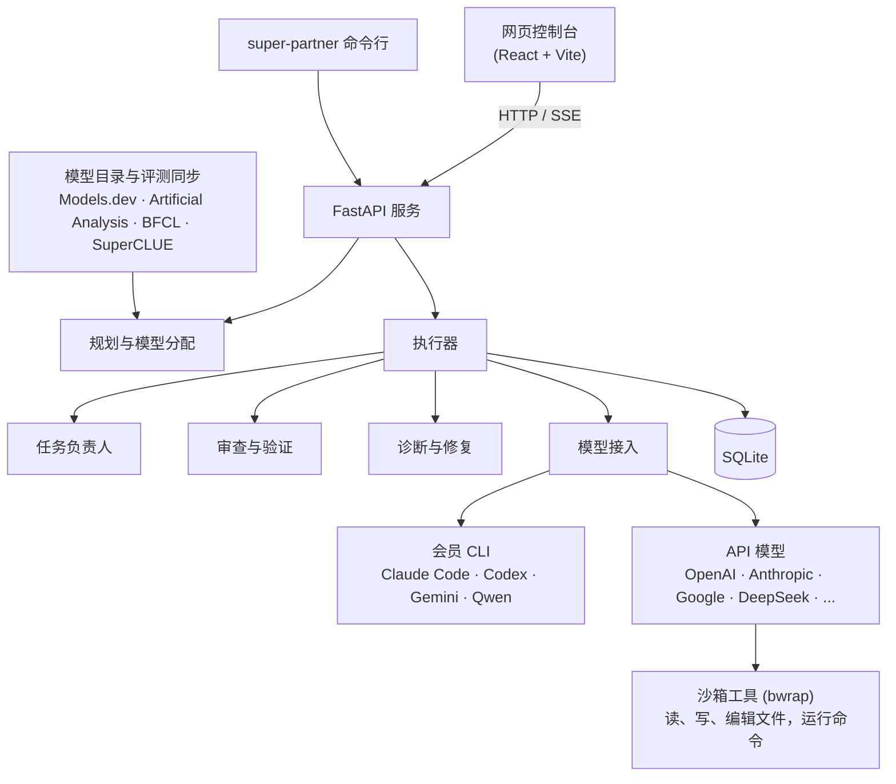

<p align="center"></p>

<p align="center"><a href="README.md">English</a> | <b>简体中文</b></p>

# Super Partner

本地优先的多模型任务编排工具，适用于软件开发和调研类任务。它把工作规划成一张依赖图，为每个节点挑选能胜任且最便宜的已配置模型，先估算费用、只请你确认一次，然后自主执行，全程留有审计记录，并受预算熔断保护。

任务规划使用规划和可靠性评分最高的已配置模型，生成经过校验的 JSON 依赖图。模型给出的计划无效、模型不可用或计划有环时，退回到确定性规划器。规划出的每个节点各自分配给满足能力和上下文要求、价格最低的已启用模型，已登录的会员 CLI 保留优先权。

规划可以用会员 CLI，但子任务及其审查优先交给 API 模型：只有没有任何已启用的 API 模型能做（达不到能力门槛，或都不能操作项目）时，才由 CLI 接手子任务。每个节点都会记录选择该模型的原因。设置 `SUPER_PARTNER_SUBTASKS_PREFER_API=false` 可恢复 CLI 优先的分配方式。启动时会安全地检测 Codex CLI、Claude Code、Gemini CLI 和 Qwen Code，不暴露账号信息。CLI 失败时，只有在对应 API 已配置密钥、该 API 模型已启用、且预估费用不超过剩余预算时，才会改用对应的 API。

**主要特点**

- 每个任务由一个强模型负责到底：规划依赖图，每次失败后决定下一步怎么做，任务结束前检查整体结果。
- 每一步交给“够用且最便宜”的模型，依据公开评测成绩挑选。会员 CLI（Claude Code、Codex、Gemini CLI、Qwen Code）和九家服务商的 API 模型可以协同工作。
- 步骤在沙箱中运行，并由另一个模型按验收标准审查结果。
- 失败会被诊断：缺的工具会被装上，额度用完的模型会被替换，Super Partner 自身的缺陷也能自动修复并测试。
- 预算上限、执行前只需确认一次、完整的审计记录。

## 截图

| 确认计划和预算 | 步骤全部完成（深色主题） |
|---|---|
|  |  |



<sub>截图使用内置的离线演示模型（`mock:local`），所以任务瞬间完成，几乎不花钱。</sub>

## 工作原理





模块级的说明见 [`docs/ARCHITECTURE.md`](docs/ARCHITECTURE.md)（英文）。

## 本地运行

### 一条命令启动

```bash
./start.sh
```

首次运行会安装缺少的后端和前端依赖。打开 <http://127.0.0.1:5173>，用 `./stop.sh` 停止全部服务。运行日志在 `.super-partner/logs/` 下；服务管理可用 `./scripts/service.sh status` 或 `restart`。

有 systemd 用户管理器时，启动脚本把 API 和网页控制台作为两个独立的用户服务运行，不依赖启动它们的终端或自动化会话。进程出错会自动重启，`stop.sh` 会停止这些服务。没有用户管理器时，启动脚本改用后台进程。日志在多次启动间追加写入。

### 手动启动

```bash
python -m venv .venv
source .venv/bin/activate
pip install -e '.[dev]'
uvicorn super_partner.api:app --reload
```

另开一个终端：

```bash
cd frontend
npm install
npm run dev
```

打开 <http://localhost:5173>。内置的演示模型不需要任何凭据，可以直接体验完整流程。也可以用 `docker compose up --build`。

### 前端交互测试

运行 `npm --prefix frontend test` 执行 DOM 交互测试。测试会挂载真实的应用并使用隔离的任务数据，覆盖从列表或详情页删除、取消运行中的任务、关闭确认框、重试、网络错误和过期的轮询响应。测试中关闭了浏览器原生确认框，以模拟内嵌浏览器的情况。不会访问真实的任务记录。

## 命令行

```bash
super-partner models
super-partner plan "Research and implement a health endpoint" --budget 2
super-partner plan "Use APIs only" --no-use-cli
super-partner plan "Fix the flaky test" --project ~/prj/my-app
super-partner run TASK_ID
```

## 在已有项目上工作

给任务指定一个项目目录，会员 CLI 代理就会直接修改该工作区：

```bash
super-partner plan "Fix the failing login test" --project ~/prj/my-app
```

在网页控制台中，点击输入框下方的项目目录栏：它会列出最近用过的项目和在允许范围内找到的 git 仓库（最近活跃的在前），并实时检查输入或粘贴的路径，显示其分支和未提交的改动。**浏览…** 会在运行 API 的机器上打开桌面系统自带的文件夹选择框，从当前目录开始（需要 `DISPLAY`/`WAYLAND_DISPLAY` 和 `zenity`，否则按钮不显示）。

- 目录必须是已存在的绝对路径，位于 `SUPER_PARTNER_PROJECT_ROOTS`（JSON 列表，默认是你的 home 目录）之内，且不能是 Super Partner 的数据目录。
- 规划器能看到项目的顶层结构和 git 状态，并标出哪些节点需要读取或修改项目文件。只有这些节点在项目中运行，其余节点在临时工作区中运行。
- 项目节点只分配给会员 CLI 或支持工具调用的 API 模型（见下文）；CLI 项目节点失败时不会退回 API。修改同一项目的节点一次只运行一个，跨任务也是如此。
- 每次运行都会把起始的 git HEAD、分支和未提交文件数记录为 `workspace.snapshot` 事件。代理被要求不提交，所以请用 `git diff` 查看改动，必要时用 `git checkout`/`git stash` 撤销。从干净的工作区开始最省事。

## 仅限本机访问

API 可以驱动会修改本地文件的 CLI 代理，所以它只响应 `Host` 在 `SUPER_PARTNER_ALLOWED_HOSTS` 中的请求（默认 `["127.0.0.1", "localhost", "::1"]`，可以防御 DNS 重绑定攻击），并拒绝来自 `SUPER_PARTNER_ALLOWED_ORIGINS`（默认是 5173 端口的网页控制台）之外的浏览器来源的写操作请求。Docker Compose 只把两个端口发布在 `127.0.0.1` 上。

如果 API 在任务排队或运行时停止，下次启动时任务会变成**已暂停**，而不会自行恢复；请先检查项目状态，再从控制台继续。

## 服务商凭据

设置 `OPENAI_API_KEY`、`ANTHROPIC_API_KEY`、`GEMINI_API_KEY`、`DEEPSEEK_API_KEY`、`DASHSCOPE_API_KEY`、`ARK_API_KEY`、`ZHIPU_API_KEY`、`MINIMAX_API_KEY` 或 `MOONSHOT_API_KEY`。也可以通过 `PUT /api/providers/{provider}/key` 提交服务商密钥，它会保存在操作系统的密钥环中。任何 API 响应都不会返回密钥。

启动时最多等待十秒读取密钥环中保存的凭据。如果密钥环被锁或没有响应，应用会先用环境变量中的凭据和可用的 CLI 启动。解锁桌面密钥环并重启即可加载保存的 API 密钥。

标记为 `pricing_verified: false` 的模型使用的是占位价格，在对费用敏感的生产场景中使用前必须核对。没有任何服务商密钥时，本地演示模型仍是安全的默认选项。

## 模型目录自动更新

**模型画像** 页面显示模型目录、各服务商的同步结果、发布日期、元数据来源，以及 **立即更新** 按钮。模型按发布日期排序，可按服务商筛选。API 启动时会在后台刷新已过期的目录，之后运行期间每 24 小时刷新一次；失败的来源一小时后重试。

公开的 [Models.dev 目录](https://models.dev/) 提供 OpenAI、Anthropic、Google、DeepSeek、通义千问（中国）、豆包、智谱、MiniMax（国际）和 Kimi（中国）的文本模型元数据，与应用使用的推理区域一致。这个社区维护的目录可能晚于厂商发布。它提供的是参考起步价，不是完整的计费计算（上下文分档、缓存、模态以及地区或账户条款都可能不同）。

配置了密钥时，应用还会查询以下官方模型列表接口（含分页）：
[OpenAI](https://developers.openai.com/api/reference/resources/models/methods/list)、
[Anthropic](https://platform.claude.com/docs/en/api/models/list)、
[Google](https://ai.google.dev/api/models) 和
[DeepSeek](https://api-docs.deepseek.com/api/list-models/)。其余五家目前只用公开目录。这些元数据请求不会产生推理调用。密钥只发送到对应的固定官方 API 地址，绝不会发给 Models.dev。被 API 列出并不保证每个账户或接入点都能调用该模型。

同步会保留模型开关、已有的能力评分、明确核实过的价格以及历史条目。最新公开目录中不再出现的模型会被标记为未列出，而不是删除。失败或格式错误的响应不会覆盖上一份可用的目录，重启后也一样。CLI 条目仍代表本机检测到的通道。

新模型不会被编造评分：未知的能力评分、价格和上下文上限都显示为未知。公开评测成绩单独导入，见下文。新条目默认停用，在补齐必需的元数据并有 Artificial Analysis 成绩之前不会参与分配。已退役的模型以及在成功获取的官方列表中不存在的模型，不会被分配新任务。

`.env` 中的可选设置：

```dotenv
SUPER_PARTNER_CATALOG_AUTO_SYNC=true
SUPER_PARTNER_CATALOG_SYNC_INTERVAL_HOURS=24
```

间隔可设为 1–720 小时。关闭自动同步后仍可手动刷新。

## 公开评测成绩

**模型画像** 默认只用 **Artificial Analysis**（AA）的成绩来显示评分、雷达图、覆盖数量、**仅有 AA 成绩** 筛选和对比表。没有匹配 AA 成绩的模型保持无评分，即使有其他评测也一样。用 **评分依据** 选择器可以把整个页面切换到 BFCL、SuperCLUE 或 **调度评分（高级）**；重新打开页面时会回到 AA。按调度评分排序只在调度评分视图中可用。

公开成绩保留来源链接、评测版本、日期和推理设置。对比表只用一个来源和版本，可选按配置筛选。缺失的测量值保持缺失；指数值不会被换算成百分比。

目录更新器也会同步以下来源，各自有独立的持久缓存：

- [BFCL](https://gorilla.cs.berkeley.edu/leaderboard.html)：官方 CSV 及排行榜的版本和更新日期；函数调用、多轮、搜索和记忆成绩。FC 和 Prompt 两种成绩分开保存。
- [SuperCLUE](https://www.superclueai.com/)：公开网站使用的原始工作簿。导入器从网站的图表模块中找出当前评测月份，而不是写死某个月份的工作簿。只读取缓存的表格数值。网站结构变化或文件无效时，会显示同步错误，并保留上一次成功的结果。
- [Artificial Analysis](https://artificialanalysis.ai/leaderboards/models)：没有密钥时，从公开排行榜渲染出的表格中导入 Intelligence Index 成绩，并从同一公开页面附带的图表数据中导入七项能力测量：SciCode、Terminal-Bench 4.0、HLE、CritPt、AA-LCR，以及 AA-Omniscience 的准确率和非幻觉率。公开 JSON 直接解码，不执行 JavaScript。单项评测的比例乘以 100 换算成百分比；综合 Intelligence Index 单独保存。分项成绩必须在模型页面标识、服务商、推理设置和四舍五入后的总分上都匹配。雷达图的坐标轴固定；缺失的轴显示 **暂无**，不画零点也不填充多边形。只有指数的模型仍会显示图框并附说明。导入器保留显示的总分精度、推理设置、模型链接和来源中的星号注释。缺失的成绩（`--`）保持缺失。页面没有标明评测版本或日期，所以这些字段明确标为未提供，而不是填成获取日期。不会执行任何页面脚本。在 `.env` 中设置可选的 `SUPER_PARTNER_ARTIFICIAL_ANALYSIS_API_KEY`（或导出 `ARTIFICIAL_ANALYSIS_API_KEY`）并重启后，会使用分页的[免费版 API](https://artificialanalysis.ai/data-api/docs)，在公开的单项测量之外补充 Coding 和 Agentic 指数。公开页面获取失败不会丢弃已成功获取的 API 指数。密钥只发送给 API，不会用于公开页面请求、其他来源或浏览器。成绩同步不会发起任何模型推理请求。

匹配要求服务商相同，且标识符在格式规范化后完全一致，或者显示名称唯一匹配。模型的快照日期和档次/版本数字都会保留。早于模型目录发布日期的评测不会关联到该模型。每条成绩保留自己的推理和工具配置；应用不会悄悄挑选最好的变体，也不会对不可比的评测取平均。这些来源没有覆盖的模型会继续显示没有公开成绩。滚动更新的 API 别名即使名字不变，背后的模型也可能变化，所以评测日期和配置仍然重要。

## CLI 代理的权限

两种会员 CLI 都只在沙箱中运行 shell 命令，所以任务可以运行语法检查、测试和脚本，而无需有人逐条批准：

- Codex 以 `--sandbox workspace-write` 运行。
- Claude Code 使用其 bubblewrap 沙箱（`sandbox.enabled`、`autoAllowBashIfSandboxed`，以及 `allowUnsandboxedCommands: false`，命令无法申请离开沙箱），并以 `--permission-mode acceptEdits` 允许修改文件。在 Linux 上需要 `bwrap` 和 `socat`。

命令只能写入工作目录（任务的临时文件夹或项目）和 `/tmp`，并且没有网络，所以安装软件包或获取 URL 会失败。规划器知道这些限制，因此验收标准会保持可实现。

### 为单个任务开放网络

任务默认离线。**允许联网**（在新任务表单、计划确认栏、继续执行栏和任务的“详情”标签中；也可在 `POST /api/tasks` 中传 `allow_network`，或用 `PUT /api/tasks/{id}/network` 提交 `{"allow": true}`）让该任务的命令从下一次模型调用起可以访问互联网。需求变更会继承这个设置。

- API 模型的命令通过 `pasta`（passt）获得独立的网络命名空间：可以访问互联网，但不转发任何主机端口，也不映射主机的回环地址，所以本应用的 API 和其他本地服务都无法访问。如果服务器的 `HTTP(S)_PROXY`/`ALL_PROXY` 指向回环地址上的代理，那是唯一被转发的端口，这些变量也会保留。没有 `pasta` 时，沙箱会共享主机网络，本地服务也能访问。
- Claude Code 的沙箱允许 `localhost`/`127.0.0.1`/`::1` 之外的所有域名；Codex 获得 `sandbox_workspace_write.network_access=true`。Gemini 和 Qwen 本来就不在沙箱中运行。
- 平台修复的验证遵循同一任务的 **允许联网** 设置，每轮验证前重新读取。开启时，检查使用与任务命令相同的网络隔离和代理设置；关闭时，检查保持离线，并明确跳过需要实时网络的测试。源文件、真实任务数据和凭据的隔离保持不变。
- 当某一步因为运行时必须访问互联网而失败，诊断会直接询问而不是猜测，提供 **允许本任务联网** 选项；选择后会开启该设置并重试这一步。缺少的软件包仍由诊断安装到共享工具目录中，所以任务不需要为了获取依赖而联网。

## 任务负责人

规划任务的强模型会在同一个对话中一直负责这个任务，直到结束（设计文档：[`docs/design/supervisor.md`](docs/design/supervisor.md)）。优先使用能保持会话的会员 CLI（Claude Code：`--session-id` 然后 `--resume`；Codex：`exec` 然后 `exec resume`），且为只读模式；否则使用最好的 API 规划模型，其对话历史随任务保存，每条消息都会重新发送。对话保存在任务上（`supervisor`），所以重启后可以继续。丢失的对话会用同一个模型根据任务记录重建；模型不可用时，任务会交给下一位负责人（`run.lead_changed`）。在任务视图中，**负责人** 面板显示负责人的每个决定及其理由和指示、它提出的问题（在这里回答），以及一个给它留言的输入框；`POST /api/tasks/{id}/lead` 会立即保存消息，负责人的回答随后出现在 `lead_messages` 中。下方的诊断面板只显示没有负责人参与时运行的诊断，或负责人派去修复问题的诊断。

一次失败的尝试会连同证据（失败原因、这一步的回答和工具调用、之前的尝试、所有步骤的进展、能接手这一步的模型）交给负责人，而不是每次都新开一个诊断。负责人用一个决定加一条理由作答，显示为 `run.decision`：`retry`（附带指示）、`switch_model`、`accept`（检查不通过也接受结果）、`unable`、`ask_user`（像诊断问题一样显示，回答会送回负责人），或 `repair_environment` / `repair_platform`，按其说明运行修复会话。某一步超过 `SUPER_PARTNER_MAX_NODE_DECISIONS`（5）个决定，或整个任务超过 `SUPER_PARTNER_MAX_RUN_DECISIONS`（25）个决定时，任务暂停；继续执行会重新给一份额度。验证失败也会先交给负责人，再决定是否退回：它判断这些问题是真问题、任务从未要求的新需求，还是验证本身的错误，然后对它选定的步骤返工并说明要改什么（`rework`），或接受，或重新验证。没有负责人时，验证发现的问题会把所有被验证的步骤退回，最多 `SUPER_PARTNER_MAX_REWORK_ROUNDS` 轮。

负责人还可以修改计划（`replan`）：添加步骤，删除或重写尚未完成的步骤（已完成和运行中的步骤保留；依赖必须保持无环；新步骤和规划时一样分配模型），显示为 `run.plan_changed`。所有步骤完成后，负责人会在任务结束前对照需求检查整体结果：`done`（完成）、对任意步骤 `rework` 并说明要改什么，或 `replan` 补上缺失的部分。没有负责人能做决定时，仍沿用旧规则（尝试次数、返工轮数、每次失败一次诊断）兜底，由下文的诊断处理失败。设置 `SUPER_PARTNER_LEAD_DECISIONS=false` 可关闭这一机制。

## API 模型通过工具工作

节点在 API 模型上运行时，模型会得到五个工具，并循环工作直到给出不调用工具的回答：`list_dir`、`read_file`、`write_file`、`edit_file` 和 `run_command`。循环使用各服务商自己的工具调用格式（OpenAI 兼容的 `tools`/`tool_calls`、Anthropic 的 `tool_use`/`tool_result`、Gemini 的 `functionCall`/`functionResponse`），所以 API 模型能像 CLI 一样修改项目、运行检查。

每次请求都按目录中该模型自身的输出上限申请（目录没有给出时为 32768 token）。DeepSeek 推理模型的思考深度由 `SUPER_PARTNER_DEEPSEEK_REASONING_EFFORT` 决定（作为 `reasoning_effort` 发送；默认 `max`，最深；`none` 关闭思考）。思考越深越慢，消耗的输出 token 也越多。

- 文件工具会把每个路径解析到工作目录内（包括符号链接），拒绝任何越界访问。
- `run_command` 在 bubblewrap 下运行：系统只读，home 目录被替换成一个空的内存目录，只挂载可写的工作目录，`/tmp` 是私有的，没有网络，环境变量被清空，所以 API 密钥永远不会进入命令。没有 `bwrap` 时不提供这个工具。
- 本地服务（例如 EDA 许可证服务器）可以按端口逐个放行，其余一切仍然离线。`SUPER_PARTNER_SANDBOX_HOST_PORTS` 列出主机端口。每个端口通过挂载进沙箱的 Unix socket 提供服务，沙箱内由 `socat` 在同一端口监听。`SUPER_PARTNER_SANDBOX_ENV` 列出要复制进沙箱的主机环境变量；列出 `PATH` 会使用主机的 PATH。对于 Synopsys 工具，请在许可证文件中固定 vendor daemon 的端口（`VENDOR snpslmd port=27021`），并把它和 lmgrd 的端口一起列出：

  ```
  SUPER_PARTNER_SANDBOX_HOST_PORTS=[26585,27021]
  SUPER_PARTNER_SANDBOX_ENV=["PATH","VCS_HOME","VERDI_HOME","SNPSLMD_LICENSE_FILE","VCS_ARCH_OVERRIDE"]
  ```

  只有 API 模型的命令能用这些端口；会员 CLI 的沙箱仍然离线。
- 每次收到的用量报告都会立即计费，包括失败、换模型、取消或达到轮数上限之前的那些轮次。每次 API 请求前，执行、审查和诊断调用会按保守的输入估算和有上限的输出 token 数共享预算预留。调用会等待其他预留释放；剩余资金不足时任务暂停，且不消耗质量重试次数。最终回复也会被检查。服务商从未报告的用量无法还原。
- **轮次与进度检查。** 一轮是一次模型请求，可以包含多个工具调用；提示词要求模型把互不依赖的调用合并在一轮，并一次写完整个文件。默认情况下，无论 API 模型还是会员 CLI，步骤都没有轮数上限，也没有固定超时。取而代之的是：一次尝试每进行 `SUPER_PARTNER_PROGRESS_CHECK_MINUTES`（10）分钟，就由另一个模型查看它在做什么（API 模型看最近的工具调用；CLI 看它修改的文件和运行的进程），判断它是否仍有进展。持续推进的长时间工作会继续；被判定卡住的尝试（重复自己、以同样方式失败、等待不会到来的东西、偏离这一步）会被停止，和其他失败的尝试一样处理，不会退回 API 模型。每次检查是一个 `node.progress_check` 事件。无法完成的检查会让尝试继续；任务预算仍然适用。`SUPER_PARTNER_API_AGENT_MAX_TURNS` 可设置一个可选上限（简单 ×1、一般 ×1.5、困难 ×2）：距上限五轮时，模型会被告知收尾；到达上限时，模型给出进度总结，该总结会被审查并带入下一次尝试。没人检查的工具循环（诊断）在 40 轮停止。`read_file` 每次调用最多返回 1200 行。
- **工具调用记录。** 一次尝试中的每个工具调用都会记录下来（轮次、工具、文件或命令、是否成功），在计划视图中折叠显示在该尝试下方；诊断会得到各工具的调用次数和最近一次尝试的调用记录。
- **连续失败两次。** 同一个模型在某个节点上连续失败两次（被拒绝、验证失败、出错以及用完轮数都算，最后一种即使模型声称这一步无法完成也算；服务商限额、取消和未经验证的审查不算），下一次重试会交给其他最强的合格模型，包括会员 CLI，即使在 API 优先策略下也是如此。之后的重试不会再交回在该节点上失败过两次的模型。规则见 `backend/super_partner/recovery.py`。
- 标记为不支持工具的模型和离线演示模型只能用文字回答，不会被分配到项目节点。设置 `SUPER_PARTNER_API_AGENT=false` 可关闭工具。

规划和审查调用仍是不带工具的单次请求。

## 节点之间如何交接和检查

依赖全部成功的节点会在有空位时立即开始，同时最多 `max_parallel_nodes` 个，且受预算约束。每个节点的提示词包含它的验收标准、需要修复的问题，以及每个直接依赖的结果——超过 `handoff_max_chars`（4000）时改为审查者对它的总结——和该依赖修改过的文件。计划视图会记录每个节点收到的是哪种形式。

**验收审查。** 节点完成后，另一个模型会对照该节点的验收标准检查结果，回答通过或不通过，并给出原因和修改建议。审查者尽量不是完成这项工作的模型，并遵循配置的 API 优先策略。真实任务的恢复和审查不使用演示模型。对于项目任务，审查者还能看到被修改的已跟踪文件的 diff。审查者出错或回答无法解析时，会换另一个可用的审查者。如果没有任何审查者给出有效结论，结果保持“未验证”，进入有限次数的恢复流程，绝不会被当作通过。设置 `SUPER_PARTNER_REVIEW_NODES=false` 可跳过审查。

**重试。** 调用失败或结果被拒绝的节点会带着问题再运行一次，使用该能力上最强的可用模型，总共最多 `max_node_attempts`（3）次。重试和其他节点一样要经过预算检查，所以预算耗尽时任务会暂停而不是超支。审查调用和其他调用一样计费。

**验证与返工。** 带有 `verifies` 的规划节点会检查那些上游节点，并以 `VERDICT: PASS` 或 `VERDICT: FAIL: <problems>` 结尾。验证不通过会带着问题重新打开被验证的节点，以及所有使用了它们结果的节点（包括验证节点本身），每个任务最多 `max_rework_rounds`（2）轮；超过后验证节点失败。正在运行的下游节点会被取消，等新的依赖完成后重新运行；代次检查也会拒绝迟到的结果。缺少结论时会重新验证，既不会当作通过，也不会把缺少结论当作上游工作本身失败的证据。

**继续执行。** 失败或取消的任务可以从中断处继续（`POST /api/tasks/{id}/resume`，可附带新预算）。已完成的节点保留结果；失败、取消和未完成的节点会重新运行，尝试次数清零，上一次的失败原因作为反馈，返工轮数也会重置。如果某个节点的模型之后被停用或失去了密钥，会先重新为它分配模型。

**暂停。** 对运行中的任务点 **暂停**（`POST /api/tasks/{id}/pause`）会阻止新步骤开始；已在运行的步骤会完成并保留结果。**按此预算继续** 会从这里接着执行。

**诊断。** **诊断**（`POST /api/tasks/{id}/diagnose`）让一个强模型分析任务为什么卡住：如果任务能用会员 CLI，就用 CLI（它能读取工作文件，且不额外花钱），否则用最好的规划模型。它会拿到需求、计划、每次尝试及审查者的理由、反馈、修改过的文件、结果和最近的事件，然后写出报告（问题定位 / 根本原因 / 处理结果与下一步），外加一条给失败步骤的 `NEXT_STEP:` 指示。对于已暂停或失败的步骤，这个按钮会走下文的环境修复和换模型流程，然后在已批准的预算内自动继续。运行中但没有停止步骤的任务只会得到分析。取消任务也会停止其手动诊断；删除任务会等执行和诊断都结束。

**交互式诊断。** 每份完成的报告（包括没有选项的旧报告）都有回复表单。可以选择一个建议选项，或写下自己的说明，或两者都提交。回复会与原报告一起保存，并作为下一次诊断的上下文；下一次诊断会使用现有预算自动开始。提交失败时会保留草稿和所选项。只有当前诊断或激活结束后才接受回复。当某项需求或用户偏好确实阻碍进展时，模型会输出中文的 `QUESTION: ...`、可选的 `OPTIONS: ["...", "..."]` JSON 数组和 `STATUS: NEEDS_INPUT`。任务会等待真正的回答，不会自动选择任何选项。已授权的常规修复会直接继续，不额外提问。回复接口是 `POST /api/tasks/{run_id}/diagnoses/{diagnosis_id}/reply`，参数为 `text` 和/或 `choice`。

**修复 Super Partner 自身。** 诊断会区分任务本身的错误、共享环境的问题，以及本应用在调度、服务商处理、持久化、API 或网页界面上的缺陷。`STATUS: PLATFORM_REPAIR` 会自动启动一个独立的源码修改阶段。它把应用源码和测试复制到 `<data_dir>/platform-repairs/<id>/source`，并以现有的本地改动为基准。修复模型在这份副本中工作，必须添加回归检查。控制器会独立检查 Python 语法、与现有数据库记录临时副本的兼容性、后端测试、前端测试和前端构建。检查失败会反馈给有次数上限的修复尝试，不会被当作成功。

所有诊断或修复平台的模型（CLI 或 API）都遵循同一套流程：[`skills/platform-repair/SKILL.md`](skills/platform-repair/SKILL.md)，模块地图见 [`docs/ARCHITECTURE.md`](docs/ARCHITECTURE.md)。修复提示词包含这两份文档；诊断会拿到它们在源码中的路径，并被告知这是关于 Super Partner 自身代码而非任务的。它们会被复制进修复源码，其中的 `AGENTS.md`（Codex 读取）和 `CLAUDE.md`（Claude Code 读取）指向它们。诊断用 `LOCATION: path:line` 行指出要修改的位置，修复从这些位置开始，而不是重新通读代码。

对于在 systemd 用户管理器下用 `start.sh` 启动的可编辑源码检出，通过检查的修复会自动生效。新工作会等待正在运行的步骤和请求结束；一个独立的工作进程会检查是否有并发的源码修改，保存数据库备份，应用补丁，重启这份检出的 API 服务，并检查新进程的健康状态。激活失败时源文件会回滚。持久化的任务标记只允许被这次修复暂停的任务在激活成功后继续，且仍在原预算之内；已取消的任务、用户明确暂停的任务和尚未回答的诊断问题都保持停止。源码改动、检查结果和激活结果都会记录到所有项目共享的恢复历史中。相关开关是 `SUPER_PARTNER_PLATFORM_SELF_REPAIR`（默认 `true`），以及可选的 `SUPER_PARTNER_PLATFORM_ROOT`（源码检出位置）。其他安装方式或服务管理器布局需要提供受支持的可编辑检出，才能使用自动激活。仅凭模型的声称不会把平台修复标记为已生效。

保存的模型选择会在确认时和执行前再次检查。已停用或失去凭据的模型会按当前的分配规则替换。

**环境修复。** 某一步每次尝试失败后（以及验证用完返工轮数时），这一步会等待，由同一个强模型查找任务之外阻碍它的原因：缺少的软件、沙箱或机器限制、配置、许可证、无法访问的服务。它会拿到计划、每次尝试和最近的事件，并被告知这一步的命令受到哪些限制。它自己的命令以当前用户身份在主机上运行，可以联网，但在 bubblewrap 之下，其 `no_new_privs` 会阻止 sudo 和其他 setuid 程序（Claude Code 关闭沙箱并使用 `bypassPermissions`，Codex 使用 `--dangerously-bypass-approvals-and-sandbox`；API 模型获得主机模式的 `run_command`，其环境中没有 API 密钥）。它不做这一步本身的工作。

修复内容放在共享工具目录 `<data_dir>/tools` 中，所有步骤都能看到：`bin/` 在 PATH 的最前面，`python/`（用于 `pip install --target`）在 PYTHONPATH 中，`sandbox.json` 记录沙箱命令可以获得的环境变量和本地端口（`{"env": {...}, "host_ports": [...]}`）。API 模型的沙箱以只读方式挂载这个目录；CLI 获得相同的 PATH、PYTHONPATH 和变量。需要 root 权限的操作会在报告中写成具体命令。

它的回答以一行状态结尾：

- `STATUS: FIXED`，并说明改了什么（`## 修复内容`）：这一步用原来的模型重新运行，以该总结作为反馈，这次失败不计入尝试次数（每步两次；之后的修复和普通重试一样计数）。
- `STATUS: RETRY`，附带 `NEXT_STEP:` 指示：任务之外没有问题，于是进行常规重试（使用最强的模型），并把建议加入反馈。某一步连续失败两次后，诊断会看到这些失败，并被告知再次 RETRY 必须实质性地改变做法。
- `STATUS: UNABLE`，附带 `USER_ACTION:`：这一步的目标在当前环境中无法实现，诊断也改变不了（没有 root 权限安装仿真器、没有许可证、没有凭据）。这一步以“无法完成”结束并附上报告，不再重试，任务的其余部分继续进行。
- `STATUS: QUOTA_EXHAUSTED`：失败步骤所用的执行模型额度或余额已用完。调度器会排除该模型，把原步骤交给一个合格的备用模型，不计为失败尝试。这也能处理错误检测器尚未识别的服务商消息。这次诊断保留在历史中，并关联到换模型事件。
- `STATUS: MODEL_UNAVAILABLE`：失败步骤的服务商过载、无法访问或超时。调度器暂时排除它并更换执行模型。
- `STATUS: BLOCKED`，附带 `USER_ACTION: ROOT|CREDENTIALS|BUDGET|DECISION: <具体需求>`：有一个只有人能解决的具体依赖需要输入，任务暂停。没有具体内容的 BLOCKED 建议按 RETRY 处理；诊断必须自己完成能做的修复，而不是把自己能执行的操作交给用户。

共享的环境修复在所有项目间串行执行。报告为 FIXED 的 `<data_dir>/tools` 下的改动会连同诊断、受影响的文件和验证报告一起记录；之后的诊断会拿到这份历史，在重复安装之前先检查已有的修复。项目专属的设置必须留在本地。`GET /api/recovery` 可查看这些记录、正在冷却的模型和已学到的错误特征。

某一步用完尝试次数，或诊断无法运行时，任务也会带着报告暂停，而不是失败。**按此预算继续** 会带着新的尝试次数和建议重新运行失败的步骤。设置 `SUPER_PARTNER_AUTO_DIAGNOSE=false` 可关闭诊断：失败后照旧重试，用完尝试次数的步骤会导致任务失败。继续执行失败的任务时，也会把最新的建议交给失败的步骤。任务页面会显示这份报告和更早的报告。

**额度用完。** 因额度而停止的模型（会员 CLI 达到使用/会话/每周/每日/每月上限，或 API 返回 429、402、余额不足）会被标记为已耗尽，直到其消息给出的重置时间（包括报告的时区），否则标记一小时（单纯的限速为五分钟）。它会从 `configured_models()` 中移除，所以所有选择都会跳过它：步骤会按常规分配规则换到备用模型（如果已经在重试，则选最强的），不计为失败尝试；规划时分配给它的后续步骤也一样；审查者、规划者和诊断者会换到下一个。没有备用模型时，任务以 `quota_exhausted` 暂停，可从 **按此预算继续** 恢复。控制台会列出已耗尽的模型及其重置时间，并提供 **恢复使用** 按钮（`GET`/`DELETE /api/models/quota`）；保存某个服务商的密钥会清除它的标记。上游 5xx 或网络故障在请求重试后也走同样的换模型流程，冷却五分钟，并使用单独的“服务故障”标签。冷却状态保存在应用数据库中，重启后仍然有效。识别出陌生额度或服务错误的诊断还会保存一条针对该模型的错误特征；其他项目再次遇到时会直接复用这个分类，无需再次诊断。清除冷却不会删除已学到的规则。每个替换模型仍要满足分配资格和预算限制。

计划视图中的每个节点都会显示检查结果、重试、收到的上游结果、修改过的文件，以及每次尝试的模型、审查者、费用和原因。

## 任务结果

**未能完成（incomplete）** 是目标在这里无法实现的任务的如实结局，而不是一个只做了准备工作的“成功”（例如部署脚本写好了，但没有网络什么也没部署）。每一步都被要求尽力完成能做的部分，并以 `UNABLE: <什么、为什么、怎样才能做到>` 结尾，而不是模拟结果；审查者被要求评判任务要求的实际效果而非准备工作，并在 `unable` 字段中写明这类限制。无论哪种情况，这次尝试都记为 `unable`：每次失败的诊断会尝试解除限制（安装软件，或请求允许联网），对错误的声称进行重试，否则这一步以 **无法完成** 结束，附上原因、诊断给出的用户操作和报告。依赖它结果的步骤会被跳过（`blocked`），任务的其余部分继续，最终任务以 `incomplete` 结束，结果开头说明哪些没能完成及原因，后面是已完成的内容。限制解除后，“重做未完成的步骤”（resume）会重新运行这些步骤；需求变更对它的作用和对其他已结束任务一样。

在已完成、失败或取消的任务的结果页上点 **需求变更**，会在原任务基础上追加，而不是从头开始（`POST /api/tasks/{id}/followup`，附带新需求和预算）。新任务会链接回原任务（`parent_run_id`），在同一个项目或同一个临时文件夹（`workspace_id`）中工作，规划时了解原来的需求、计划、结果摘要和已有的文件；它的每一步都被要求在这些基础上继续，保留变更不涉及的内容，并且只交给能编辑文件的模型。和其他任务一样，它会等待确认后才运行。对变更再做变更时，会沿用最初的文件夹和更早的背景。

已完成任务上的 **查看完整结果** 会打开结果页，显示最终结果、输出文件（可直接查看）和每一步的输出。对于没有项目的任务，输出是整个临时文件夹，去掉代理用的文件夹（`.review`、`.claude` 等）；对于项目任务，输出只包含各步骤修改过的文件。

- **另存为 ZIP** 从 `GET /api/tasks/{id}/archive` 下载输出文件和 `RESULT.md`（需求、最终结果和每一步的输出）。
- **上传到 GitHub** 把同样的文件作为 `main` 上的一个提交（`POST /api/tasks/{id}/github`）：可以推送到新建的仓库（默认私有），用保存在系统密钥环中的 GitHub token 创建（`PUT /api/github/token`）；也可以推送到一个已有的空仓库，使用本机自己的 git/SSH 配置。token 通过环境变量传给 git，绝不会出现在命令行或 URL 中。项目任务不从这里发布，因为它们的改动已在用户自己的仓库中。

## 附件

可以用 **📎 添加附件**、把文件拖到任务表单上，或在描述中粘贴截图，为任务添加图片和文件。每个文件会上传到本地 API（`POST /api/attachments?name=…`，原始请求体，单个最大 20 MB，每个任务最多 10 个文件），保存在 `<data_dir>/attachments/` 下；上传内容与内部元数据分开存放，所以 `meta.json` 这样的文件名也能保留。旧的上传路径仍可读取。删除任务会删除它的文件。类型根据内容判断：PNG、JPEG、GIF 和 WebP 是图片，UTF-8 文件是文本，其余为二进制文件。

任务的每个节点都会收到附件。会员 CLI 拿到文件路径；Codex 还会通过 `--image` 收到图片，Claude Code 通过 `--add-dir` 获得所在文件夹。API 模型以图片输入的形式收到图片，文本文件内联发送；二进制文件只提供名称。带图片的任务只会分配给 CLI 和未标记为不支持视觉的 API 模型。

## 调度评分

七项调度评分全部来自 Artificial Analysis，没有手写的预设值。每项 AA 指标按排名换算：模型在所有有 AA 成绩的模型中的百分位，被线性映射到该能力固定的区间内（例如代码为 0.74–0.97），这样规划器的门槛含义保持不变。代码使用 AA 编程指数、SciCode 和 Terminal-Bench；规划使用智能指数和 HLE；调研使用知识准确率、AA-LCR 和 HLE；工具使用使用智能体指数和 Terminal-Bench；可靠性使用非幻觉率。AA 没有中文或结构化输出的评测，所以这两项跟随智能指数。一个模型匹配到多条 AA 记录时，使用最强的那条。

会员 CLI 运行的是账户的默认模型，所以每个 CLI 继承同一厂商中 AA 成绩最好的 API 模型的评分。没有 AA 成绩的模型（以及厂商没有 AA 成绩的 CLI）没有评分：它们不参与分配，不出现在模型列表和模型页面中，也不能作为 CLI 的 API 备用。离线演示模型为测试保留固定评分，同样不在列表中显示。如果还没有缓存任何 AA 成绩，会保留上一次算出的评分。BFCL 和 SuperCLUE 的成绩仅供参考，不影响分配。

规划器把每个任务评为 **简单**、**一般** 或 **困难**，分别对应该任务所需能力的最低分 70、80 或 90。在达到门槛的模型中（只考虑 API 模型，除非没有一个合格），简单和一般任务选最便宜的，困难任务选该能力得分最高的，价格只用来打破平局。没有可用模型达到门槛时，门槛会降到可用模型的最高分，并在计划中注明。计划视图会显示每个任务的难度和门槛，模型标签会说明选择该模型的原因。

## 主要 API

- `GET /api/projects/discover` 列出允许范围内的 git 项目；`GET /api/projects/inspect?path=` 校验一个文件夹并报告其 git 状态；`GET`/`POST /api/projects/native-picker?start=` 查询并打开桌面文件夹选择框。
- `POST /api/tasks` 创建计划和估价；传入 `project_dir` 可在已有项目上工作。
- `POST /api/tasks/{id}/confirm` 确认预算并开始执行。
- `GET /api/tasks/{id}` 返回完整的依赖图和结果。
- `DELETE /api/tasks/{id}` 删除已成功、失败或取消的任务及其事件历史。历史列表和任务详情提供 **删除记录**，并在页面内弹出确认框，显示任务名称、进度和失败信息。项目文件和工作区文件会保留。未结束的任务返回 409；不存在的记录返回 404。
- `GET /api/tasks/{id}/events` 以 SSE 推送审计事件。
- `POST /api/tasks/{id}/cancel` 取消活动中的任务。**取消任务** 会在页面内弹出确认框并显示任务名称。点 **确认取消** 后，页面显示进度或错误，成功时立即更新任务状态。结果、日志和项目文件会保留。
- `GET /api/models` 列出能力、价格、凭据状态和匹配到的 `benchmarks`。
- `GET /api/models/sync` 显示持久化的各服务商更新状态和下次检查时间。
- `POST /api/models/sync` 启动后台刷新（202）；重复请求共享同一个进行中的任务。
- `PATCH /api/models` 用 JSON 字段 `model_id` 和 `enabled` 全局启用或停用模型。
- `GET /api/channels/cli?refresh=true` 重新检测已安装并已登录的会员 CLI。
- `GET /api/providers` 列出 API 连接状态，不返回密钥。
- `PUT` 或 `DELETE /api/providers/{provider}/key` 管理系统密钥环中的凭据。
- `POST /api/providers/{provider}/test` 通过服务商的模型列表接口验证凭据。

## 许可证

MIT，见 [LICENSE](LICENSE)。
